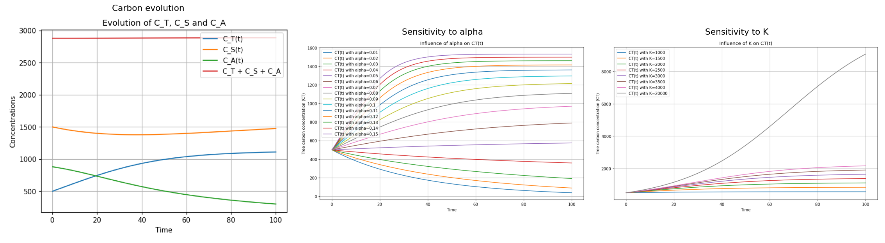

# Forest Carbon Storage Model

A system of three coupled ODEs modeling how carbon flows between the atmosphere, tree biomass and soil in a forest, solved from scratch with an implicit/explicit Runge-Kutta 2 scheme and Newton's method, then used to run a parameter sensitivity study.

Academic group project (3 students), MAM3, Polytech Nice Sophia, Numerical Analysis 2.



## The model

Three carbon pools are tracked over time:

- `CT(t)`: carbon stored in tree biomass
- `CS(t)`: carbon stored in soil (litter, dead roots, organic matter)
- `CA(t)`: carbon in the atmosphere

```
dCT/dt = -(alpha/K) * CT^2 + (alpha - beta - delta - gamma) * CT
dCS/dt = CT * (gamma + delta) - delta * CS
dCA/dt = (alpha/K) * CT^2 + CT * (beta - alpha) + delta * CS
```

with:

- `alpha`: photosynthesis rate (the only carbon input to the system)
- `beta`: tree respiration (carbon returned to the atmosphere)
- `delta`: transfer rate from trees to soil (litter, dead roots)
- `gamma`: soil decomposition rate (carbon returned to the atmosphere)
- `K`: maximum carbon capacity of tree biomass (carrying capacity)

The `CT` equation is nonlinear and stiff, so it is advanced with an implicit RK2 (Crank-Nicolson) step, solved at each time step with Newton's method. `CS` and `CA` are then updated with an explicit RK2 step using the freshly computed `CT`.

The written analysis (`docs/written_analysis.pdf`, in French) discusses the ecological meaning of each parameter and the choice of RK2 (accuracy/cost trade-off). The slides (`docs/slides.pdf`, in French) summarize the whole project.

## Repository structure

```
co2-forest-carbon-model/
├── src/
│   └── carbon_forest_model.py   # ODE system, RK2/Newton solver, sensitivity sweeps
├── results/                     # Generated figures (evolution, sensitivity, scenarios)
├── assets/                      # Visuals used in this README
└── docs/
    ├── slides.pdf                # Presentation slides (French)
    └── written_analysis.pdf      # Written interpretation of the parameters (French)
```

## Installation

```bash
git clone https://github.com/<your-username>/co2-forest-carbon-model.git
cd co2-forest-carbon-model
pip install -r requirements.txt
```

## Usage

```bash
cd src
python carbon_forest_model.py
```

Running the script first plots the baseline evolution of `CT`, `CS`, `CA` and their sum, then runs a one-at-a-time sensitivity sweep over `alpha`, `beta`, `delta` and `gamma`, `K`, plotting how each one reshapes `CT(t)` (and `CS(t)` for `delta`). Edit the parameter lists at the bottom of the script to test other ranges.

## Results

Over 100 years with the baseline parameters, the model shows trees accumulating carbon while the atmosphere compartment decreases and soil carbon slowly rebuilds, with the total carbon in the system conserved (`results/main_evolution.png`). The sensitivity study shows `alpha` (photosynthesis) as the main driver of tree carbon accumulation, and `K` setting the long-term ceiling on how much carbon the biomass can store (`results/alpha_sensitivity.png`, `results/K_sensitivity.png`). Two additional scenarios (a young forest and a deforestation case) are included in `results/` as produced for the report.

## Authors

Group project by Matthieu Keruzoret, Petru Piculescu and Camille Veillon.
